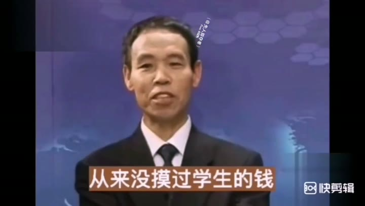
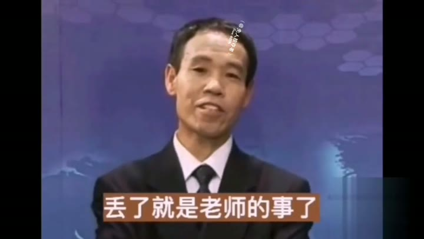
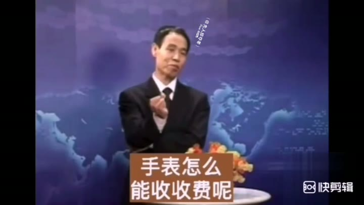
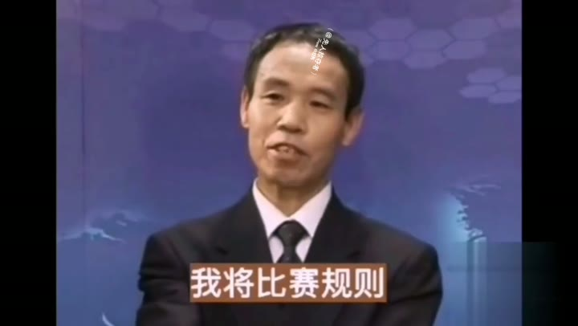

# 班主任的教学方式

> 班主任不摸钱，班干部分工+收费比赛+责任到组

## 这条讲什么

解决班主任经手学生钱款的风险和琐碎问题。作者当22年班主任从不摸钱，方法是把收费权分给学生干部：生活委员收班费、班长收学费、学习委员收书费。班主任会按学号轮流让学生代开，谁开会谁负责收书费。收费时设计成小组比赛，小组长用16开白纸登记名单和钱数，收齐包好放讲桌；学习委员只带队交费，不数钱，出错由组长赔。最快小组1分15秒完成，最慢1分45秒，全班2分钟内收齐。适合班主任、团队管理者参考，把责任和流程下放给执行者。

## 内容分节

### 00:00　班费学费书费分工

- 生活委员承包收班费
- 班长承包收学费
- 学习委员承包收书费
- 老师当了22年班主任从不摸钱

### 00:20　班主任会轮流开

- 老师从来不开班主任会
- 按学号轮流，每个同学替老师开班主任会
- 谁开会谁负责收书费

### 00:55　收费比赛规则

- 学习委员逐个座位收费被叫停
- 要求用比赛方式收费
- 小组长站在小组左侧
- 准备16开白纸，写交费人名单、钱数、总钱数
- 收完用名单包起来放讲桌

### 01:30　比赛结果与交费

- 最快小组1分15秒，最慢1分45秒
- 学习委员想数钱被阻止：谁切了谁赔
- 学习委员只带队，五个小组长拿自己组的钱去学校交
- 出错的小组长要赔

### 02:00　效果与闭环

- 每个小组再试一遍，当场通证
- 老师发现环境充满了生机和学历〔?〕

## 照着做

- 将班费、学费、书费分别指定给生活委员、班长、学习委员。
- 班主任会按学号轮流由学生代开，谁开会谁负责收费。
- 收费时由学习委员组织比赛，小组长负责本组收费。
- 小组长准备16开白纸，写名单、金额、总金额，钱用纸包好放讲桌。
- 学习委员只带队去学校交费，不数钱，出错由组长赔。

## 提到的工具

- 16开白纸：登记小组交费名单、钱数、总钱数并包钱

## 容易踩的坑

- 学习委员逐个座位收费效率低，要叫停。
- 学习委员数钱会导致责任不清，老师阻止：谁切了谁赔。
- 钱丢了是老师的责任，所以必须教会学生不丢。
- 小组长收错钱要自己赔。

## 原话

> 谁切了，谁赔

## 值得带走的

- 管理者不碰具体事务，把责任和权力下放到最小单位。
- 用比赛机制把收费流程标准化，激发执行效率。
- 让每个执行者自己承担结果，形成闭环，减少中间检查。
- 会议可以轮流派人参加，降低管理成本并锻炼成员。
- 流程设计要减少多余环节，如学习委员不数钱直接带队交。

## 总结

这套方法成立的关键是责任完全下放：小组长收钱、包钱、交钱、赔钱，学习委员只做组织，老师完全不插手。边界在于需要前期培训小组长，且班级或团队有基本执行力。最值得记住的一点是：上级领导别干下一级的活，让责任和权力一起下放到最小单位。

---
来源：[热心市民L · 班主任的教学方式](https://www.xiaohongshu.com/explore/5fd3ac540000000001007f0f?xsec_token=ABnjySaq1cPNBZbCBgLE8KQ2YSSFUCpjfm2mOWtaWPInc=&xsec_source=pc_collect)

## 相关笔记

- [[技能教程/教你把公交车拍出高级感📷赞爆朋友圈]]
- [[技能教程/近视可防可控可提升]]
- [[技能教程/喜欢侧睡？翼状肩胛 胸曲变直 练云上掏 #侧睡 #翼状肩胛 #胸曲变直训练 #体态纠正 #居家锻炼]]
