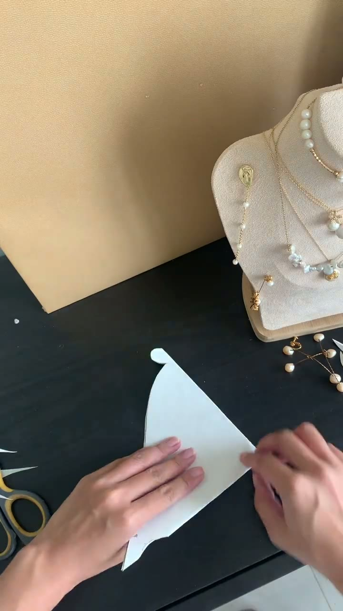
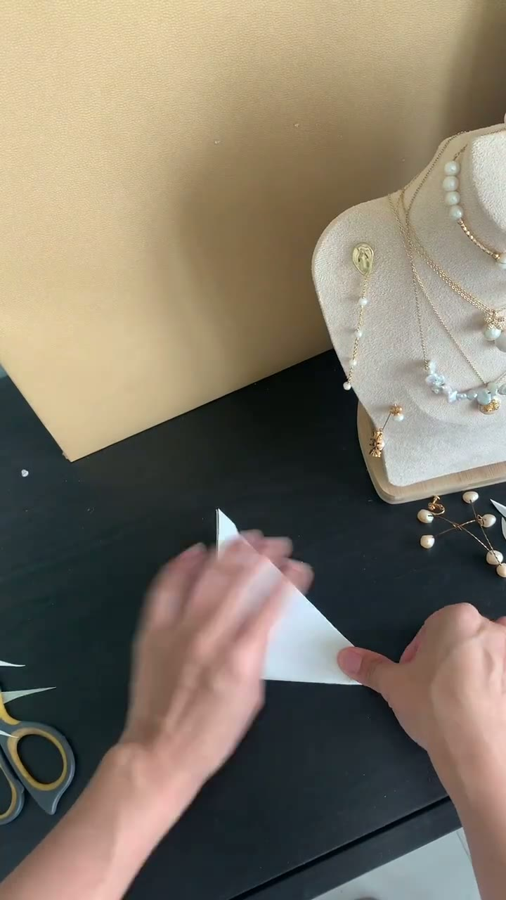
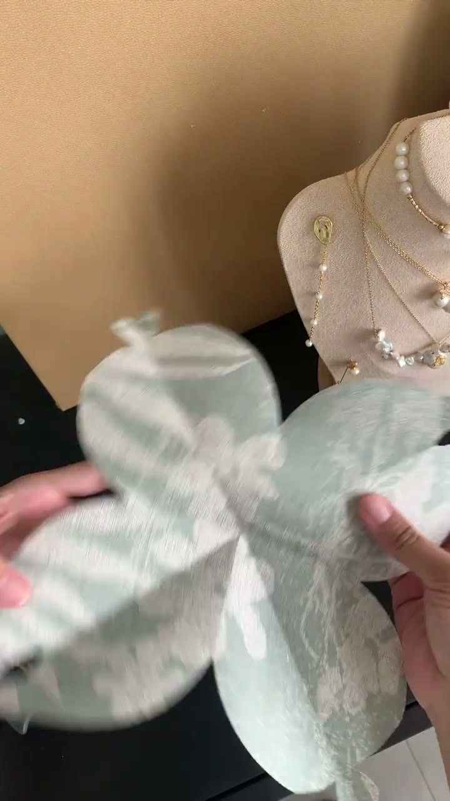
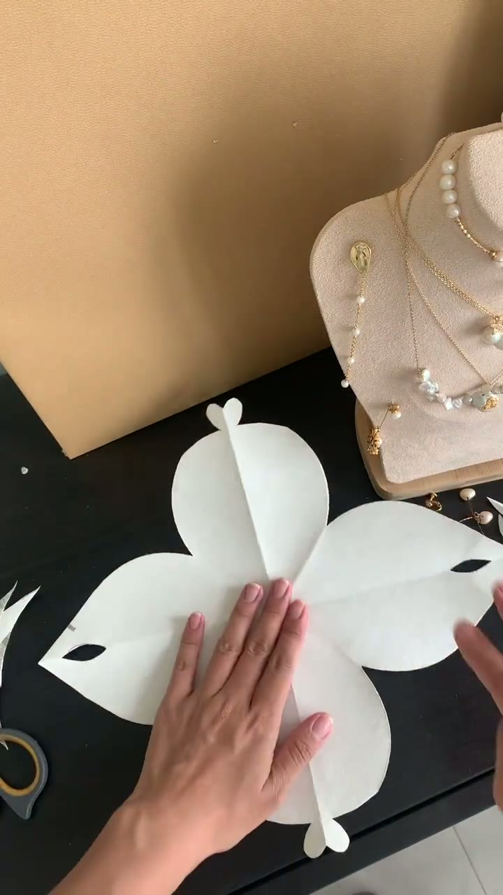
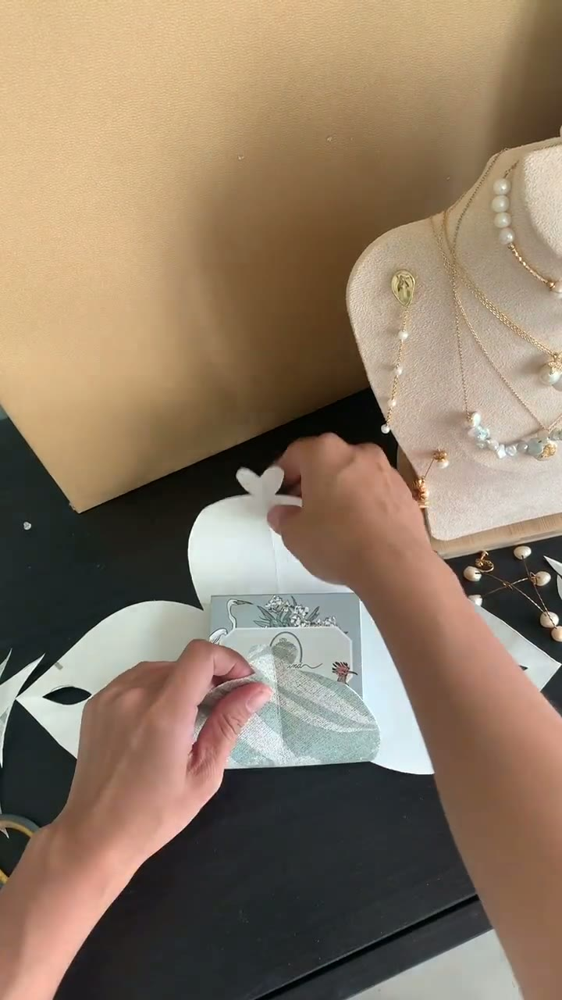

# DIY一个简约又有爱的礼品包装盒

> 逐字稿无有效内容，无法提取礼品包装信息

## 这条讲什么

当前逐字稿只包含四句不连贯英文短语：'like this say'、'oops and I'、'and I promise you'、'pulled up'。这些内容与标题《DIY一个简约又有爱的礼品包装盒》完全无关，视频字幕疑似识别错误或缺失。因此无法回答'解决什么问题、答案是什么、谁适合看'这三个问题，也无法提取任何制作步骤、材料参数、判断标准或作者提醒。为了避免补充不存在的知识与误导观众，本次不生成具体分节、步骤、工具和注意事项。这不是一个有效的知识笔记来源。需要提供正确的中文字幕或视频说明后，才能整理出可反复查看的内容。

## 图文内容

## 总结

这份笔记无法成立，因为原始逐字稿没有可验证的信息。不能仅凭标题就编造礼品包装盒的制作方法，那会违背'不补充个人知识'的原则。当前的边界是：字幕识别失败或视频缺少说明文字时，知识提取必须停止。最值得记住的一点：宁可不给出内容，也不要用看起来合理但实际不存在的步骤填充笔记。

---
来源：[清野集 · DIY一个简约又有爱的礼品包装盒](https://www.xiaohongshu.com/explore/610790d100000000010284cc?xsec_token=ABz10V6TKmMR-wHbEI28hELlZDQhZI8xuaU3dhIPpAeT8=&xsec_source=pc_collect)

## 相关笔记

- [[习惯自律/✅挑战世界公认「健康作息」｜一天学习8⃣️小时✨]]
- [[科普知识/赶紧保留，估计快失传了😄😄😄😄😄😄]]
- [[书影推荐/我的艺术美居｜空间的诗，流动的梦]]
