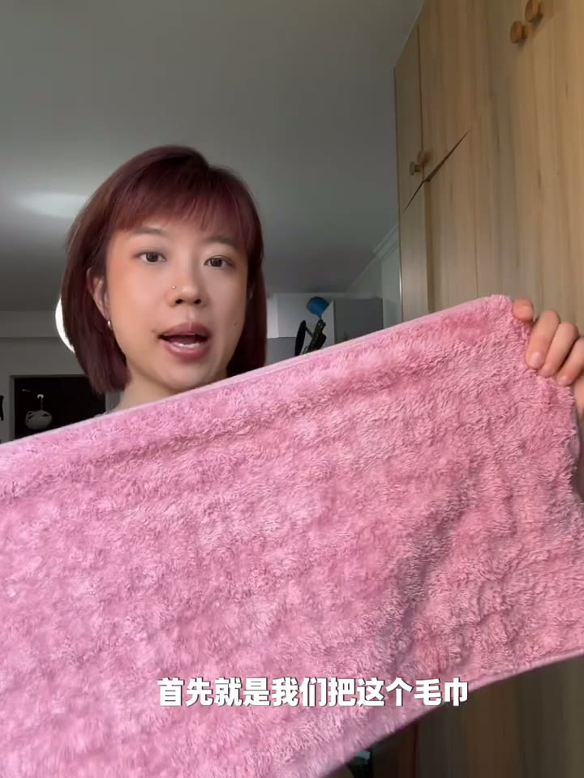
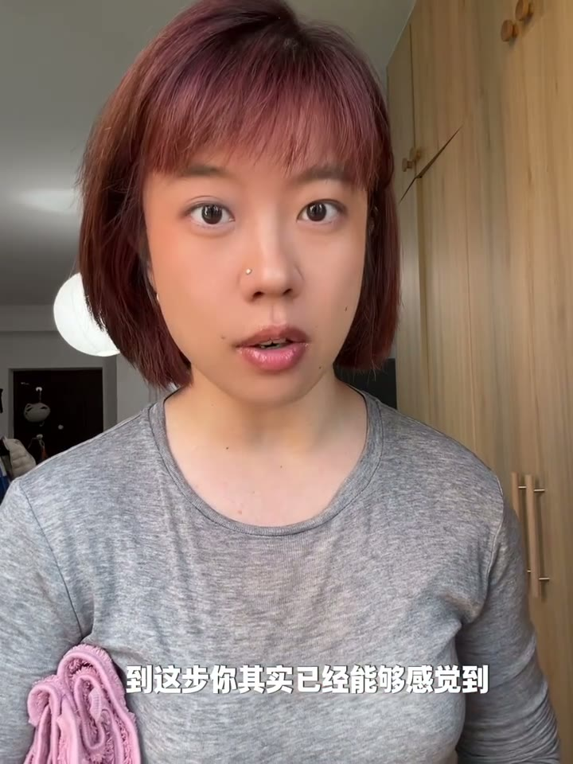
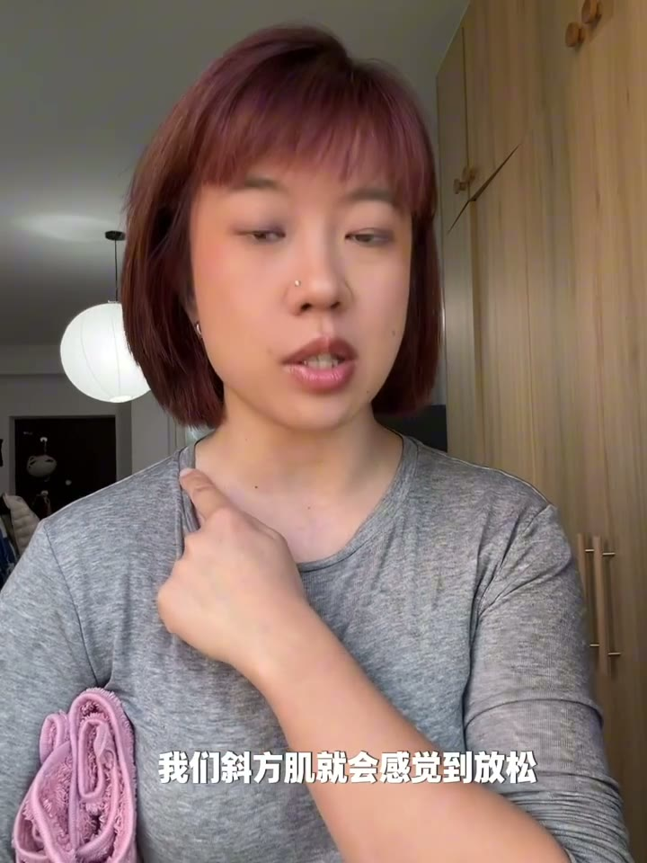
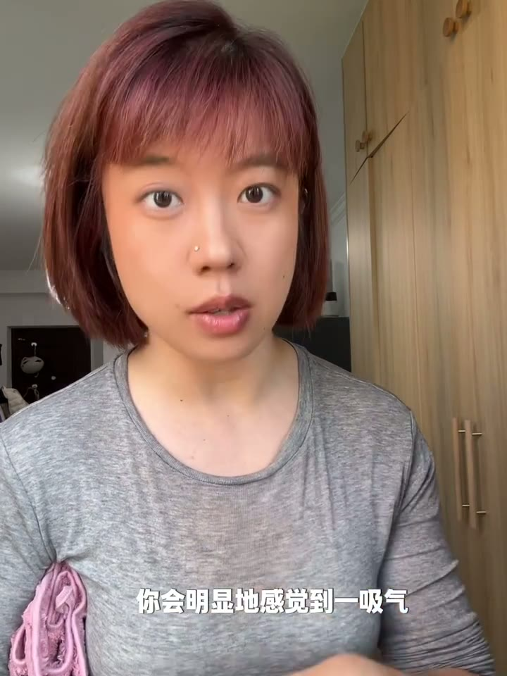

# 一个斜方肌瞬间放松的小练习

> 毛巾夹腋下垫高肩胛骨，斜方肌即可放松

## 这条讲什么

这个练习解决斜方肌紧张的问题。答案是把毛巾卷起对折夹在腋下，通过垫高使肩胛骨做一点点上回旋，斜方肌就会自动放松下来。配合呼吸能明显感觉到垫高侧横向打开，做四五个呼吸后斜方肌更放松；再做身体侧倾呼吸和肩胛骨上提放下十次，对比两侧感觉，换边重复。整个流程用一条毛巾就能完成，适合想要快速放松斜方肌的人。

## 内容分节

### 00:00　毛巾准备与夹腋下

- 把毛巾卷起来再对折，让它有一定厚度
- 把毛巾夹在腋下
- 夹上后垫高侧的斜方肌立刻变软、放松

### 00:12　肩胛骨上回旋原理

- 垫高相当于让肩胛骨做了一点点上回旋
- 肩胛骨上回旋后斜方肌会放松
- 这是斜方肌放松的关键

### 00:25　呼吸感受扩张

- 在夹毛巾位置做呼吸
- 吸气时垫高侧明显横向打开、收回
- 做四五个呼吸后斜方肌很放松

### 00:45　侧倾与上提放下

- 身体向右侧倾，再做呼吸，打开幅度更大
- 回到中间，肩胛骨做上提放下十次
- 对比两侧斜方肌感觉，换边重复

## 照着做

- 卷起毛巾，对折，让它有一定厚度
- 把毛巾夹在腋下
- 感受垫高侧斜方肌放松
- 在夹毛巾位置做呼吸，吸气时感受垫高侧横向打开，做四五个呼吸
- 身体向右侧倾，再做呼吸，感受打开幅度更大
- 回到中间，肩胛骨上提放下，做十次
- 对比两侧斜方肌感觉，换另一边重复

## 提到的工具

- 毛巾：卷起对折后夹在腋下，垫高肩胛骨

## 原话

> 垫起来的这边斜方肌会软下来

## 值得带走的

- 改变肩胛骨位置可以间接放松斜方肌
- 单侧垫高便于对比放松效果
- 呼吸时关注身体横向扩张能强化感觉
- 用毛巾这类随手物品就能做辅助练习

## 总结

这个练习成立的关键在于让肩胛骨上回旋，斜方肌不需要发力就能放松。毛巾的厚度提供了支撑，呼吸和上提动作进一步激活肩胛骨活动。边界是它针对单侧放松，需要两侧都做，且只用于放松不是力量训练。最值得记住的一点：垫高腋下就是最省力的斜方肌放松开关。

---
来源：[Benny普拉提 · 一个斜方肌瞬间放松的小练习](https://www.xiaohongshu.com/explore/69c50573000000002200f570?xsec_token=ABrJcvyzHsPLCb7JCZL0kTWcrGyFSbl1h9Zxl1JLfiENM=&xsec_source=pc_collect)

## 相关笔记

- [[技能教程/🏀转身后仰跳投教学之五]]
- [[技能教程/教你把公交车拍出高级感📷赞爆朋友圈]]
- [[学习方法/快速阅读，一目十行，过目不忘]]
