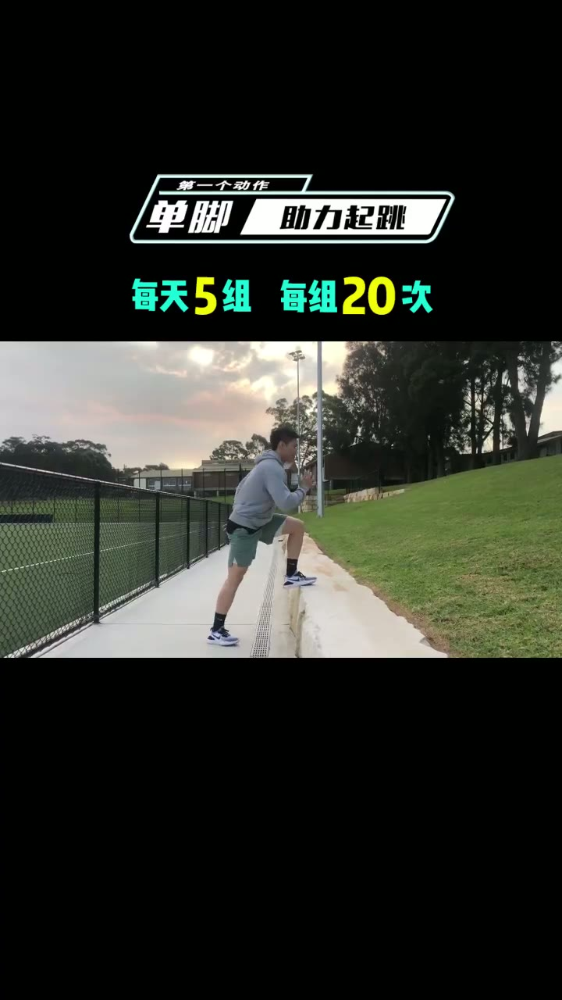
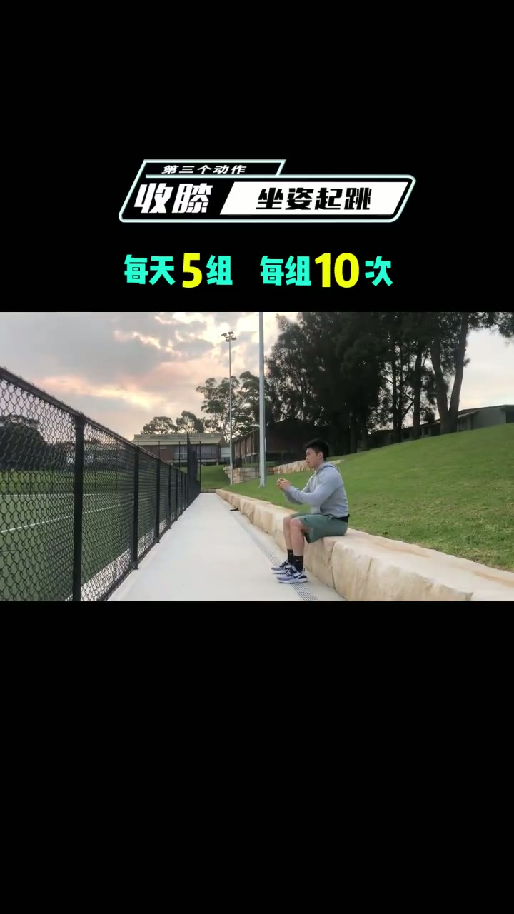
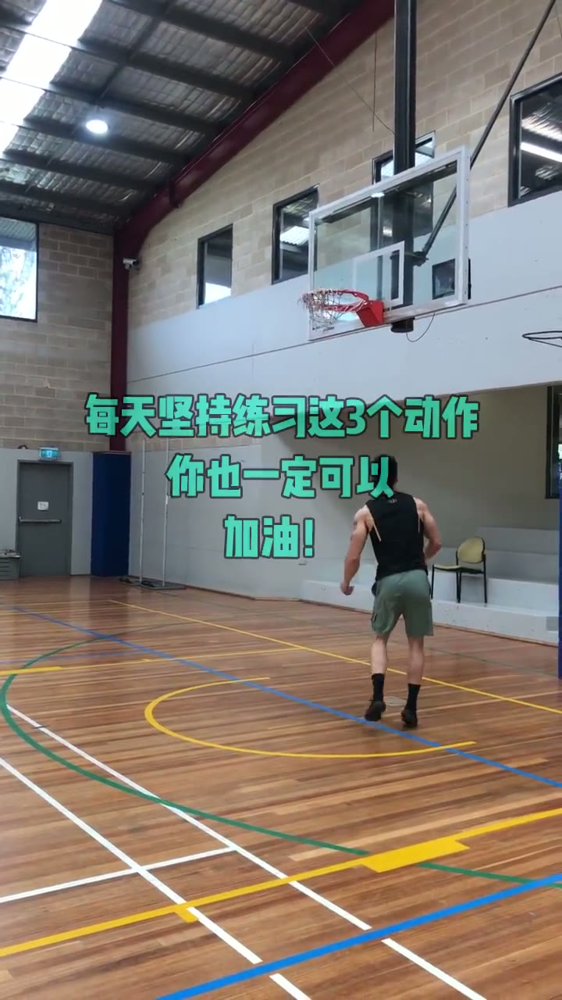

# 如何提升弹跳力

> 教三个动作提升弹跳力，让矮个也能扣篮

## 这条讲什么

视频标题为“如何提升弹跳力”，作者李艾伦，小红书平台，点赞4.5万。逐字稿仅一句：“教大家三个动作 提高强调力 让你像我一样 身高不够引发 也可以跑来”。其中“强调力”疑为“弹跳力”误识别，“跑来”疑为“扣篮”误识别。逐字稿未提供三个动作的具体做法、次数、组数、注意事项等信息，无法整理成有效知识笔记。建议补充完整逐字稿。

## 内容分节

### None　三个动作

- 教大家三个动作
- 具体动作名称和要领缺失

### None　提高弹跳力

- 目标为提高弹跳力（逐字稿中为“强调力”）

### None　身高不够也能扣篮

- 效果：让你像我一样，身高不够也能扣篮（“跑来”疑为“扣篮”）

## 原话

> 教大家三个动作 提高强调力

## 值得带走的

- 视频信息不足，无法提取可迁移原则

## 总结

该视频笔记因逐字稿信息严重缺失，无法生成有价值的内容。视频可能教授三个提升弹跳力的训练动作，但要点、参数均未给出。建议获取完整字幕后再整理，避免编造。

---
来源：[李艾伦 · 如何提升弹跳力](https://www.xiaohongshu.com/explore/5d0e2c480000000028032470?xsec_token=ABs-bZqkFZyo-uOWmAstttpMjJF2Q_024OiW6Xf2wdvvU=&xsec_source=pc_collect)

## 相关笔记

- [[技能教程/28天在家练出马甲线 拉上你闺蜜一起训练吧]]
- [[技能教程/英语音标不会读？看这个一学就会]]
- [[技能教程/DIY一个简约又有爱的礼品包装盒]]
