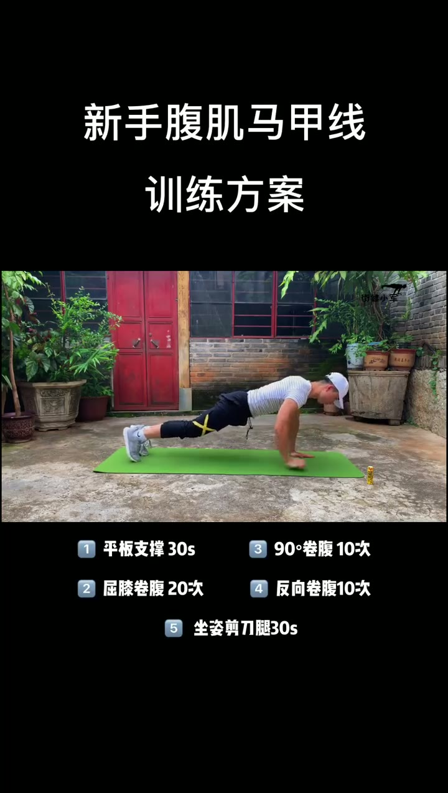

# 新手虐腹超级组

> 新手腹肌训练：5个动作，3-6组，组间休息1分钟。

## 这条讲什么

这是一个针对新手的腹肌马甲线训练方案。动作包括平板支撑30秒、90°卷腹10次、屈膝卷腹20次、反向卷腹10次、坐姿剪刀腿30秒。五个动作合为一组，建议完成3-6组，组间休息1分钟。训练时要感受腹部发力。该方案以固定次数和时长给出明确指令，适合刚开始练腹肌、想练出马甲线的新手。视频无解说，动作要点需通过示范观察。

## 内容分节

### 00:00　平板支撑

- 平板支撑 30 秒

### 00:00　卷腹动作

- 90° 卷腹 10 次
- 屈膝卷腹 20 次

### 00:00　反向与剪刀腿

- 反向卷腹 10 次
- 坐姿剪刀腿 30 秒

### 00:00　组数与休息

- 五个动作为一组
- 建议做 3-6 组
- 组间休息 1 分钟
- 感受腹部发力

## 更多画面

## 照着做

- 依次完成平板支撑 30 秒、90° 卷腹 10 次、屈膝卷腹 20 次、反向卷腹 10 次、坐姿剪刀腿 30 秒。
- 将五个动作作为一组，组间休息 1 分钟。
- 重复完成 3-6 组。
- 训练过程中感受腹部发力。

## 原话

> 五个动作为一组，建议3-6组，组间休息1分钟

## 值得带走的

- 动作以固定次数或时长定义
- 五个动作合成一组循环
- 组间休息 1 分钟
- 训练时感受腹部发力

## 总结

这个方案把五个动作打包成一组，用明确的次数、时长、组数和休息时间，给新手一个可直接执行的腹肌训练模板。它的边界在于无解说视频缺少动作细节，练习者需要自己观察示范或具备基础动作认知，避免借力。最值得记住的一点：按顺序完成五个动作，做3-6组，组间休息1分钟，并全程感受腹部发力。

---
来源：[小军i健身 · 新手虐腹超级组](https://www.xiaohongshu.com/explore/5f7f1a0f000000000101fb2b?xsec_token=ABC9xyh_3CnMp-Ur8rWgEO86xuHRzH0NaZdNzcE55cK68=&xsec_source=pc_collect)

## 相关笔记

- [[技能教程/你有这些问题吗？]]
- [[技能教程/【100个摄影技巧】天空☁️如何𝐠𝐞𝐭日系风]]
- [[技能教程/叠衣干货 冬天各类衣物叠衣教程，先收藏了！]]
