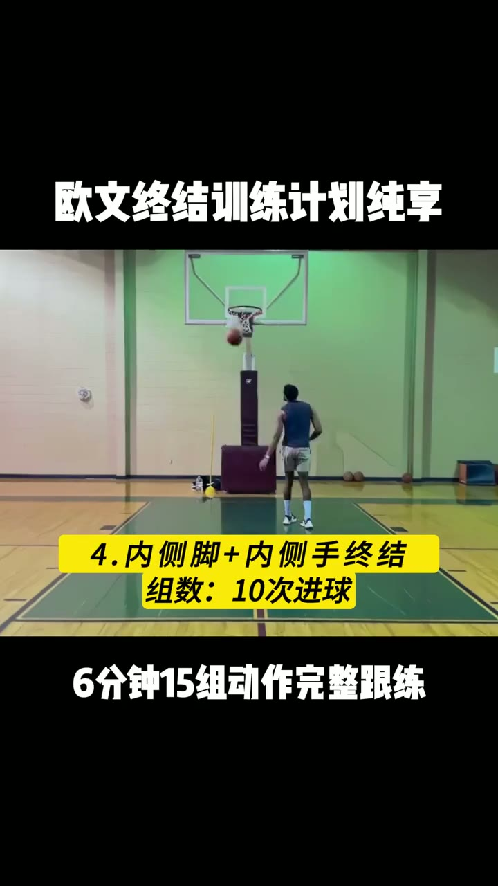
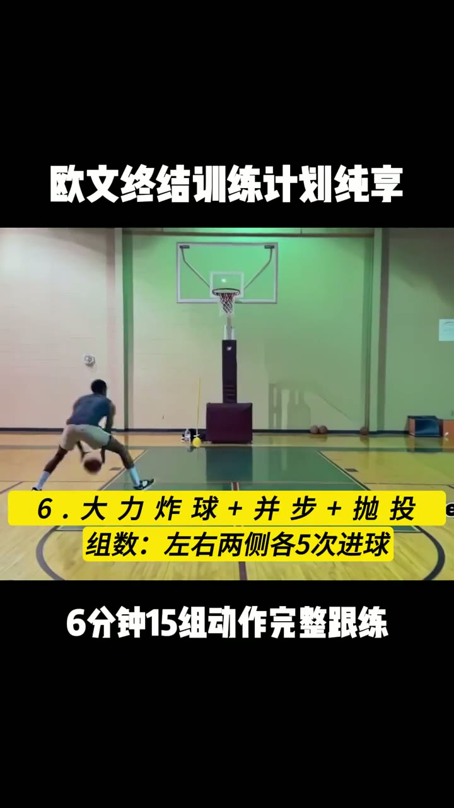
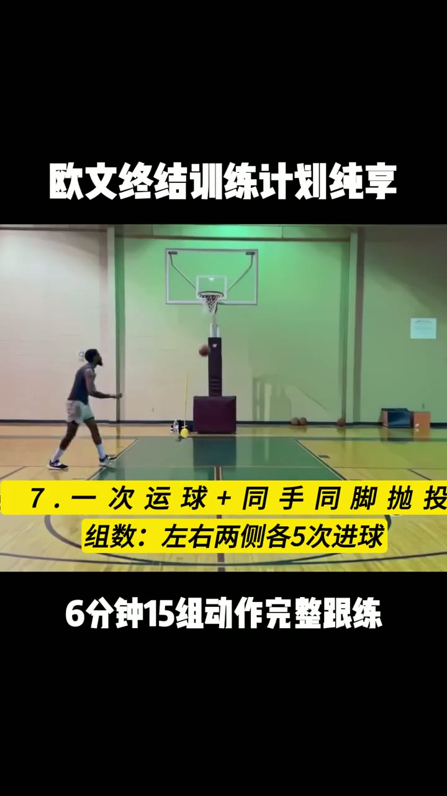
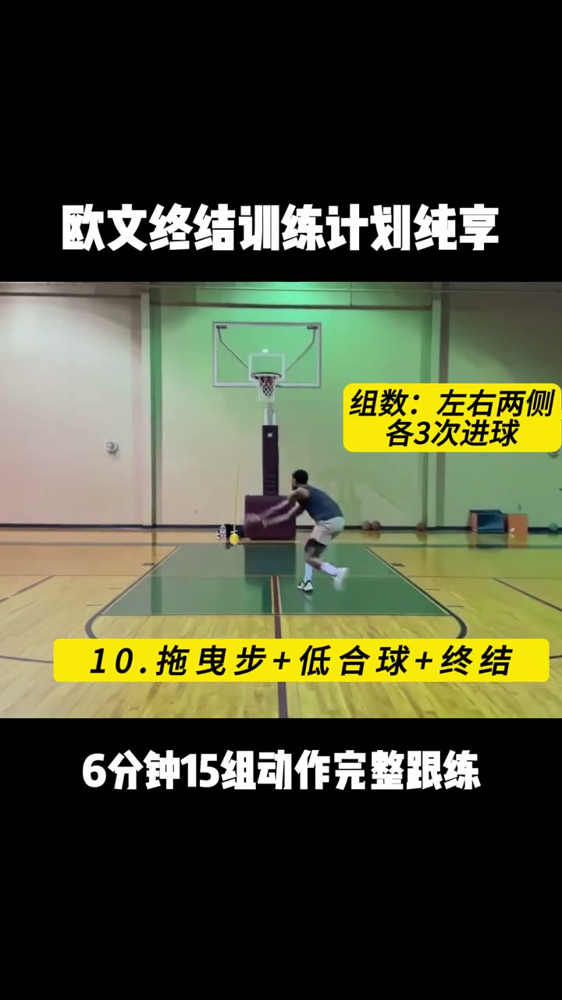
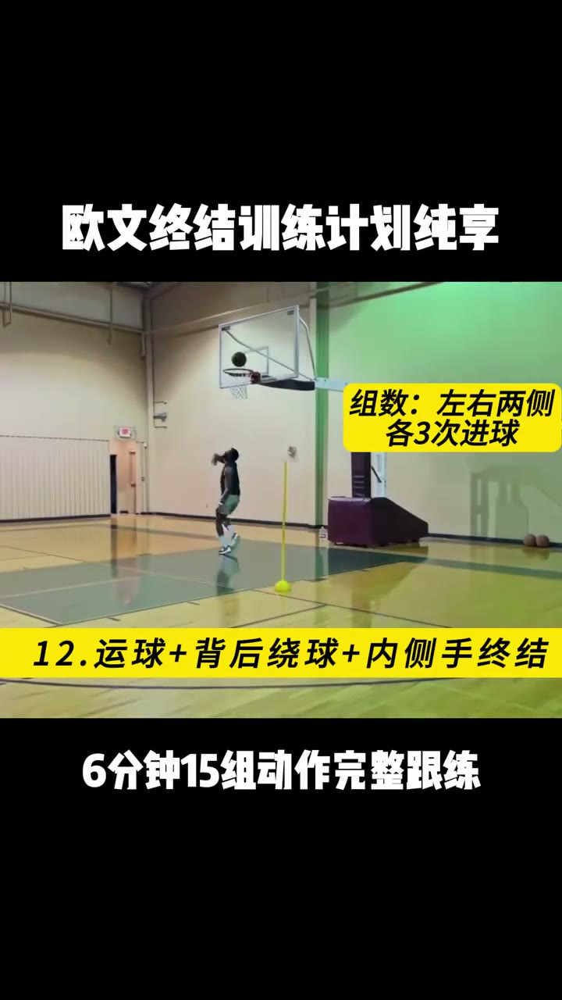
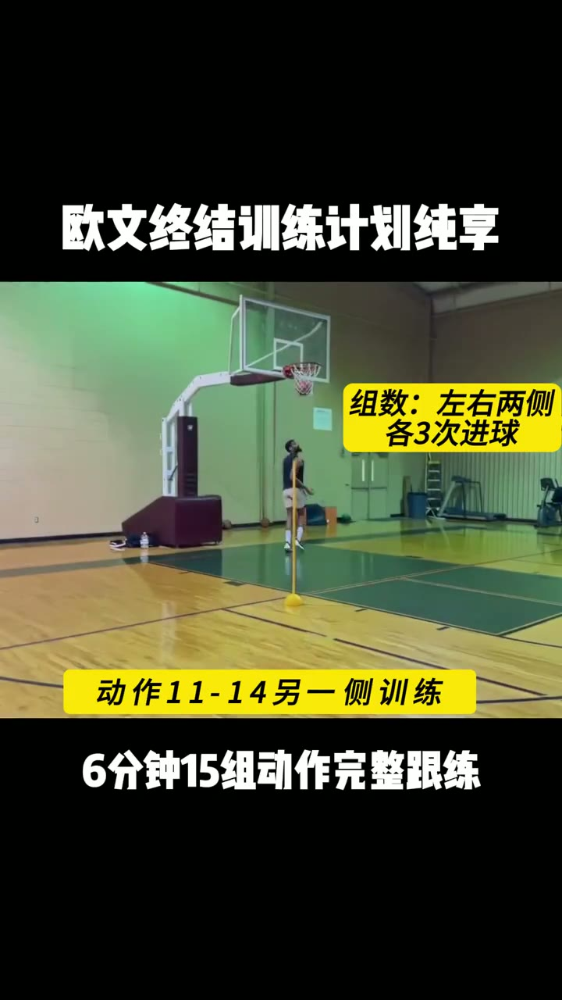

# 欧文终结训练计划纯享

> 6 分钟 15 组篮球终结跟练，左右两侧分别计数

## 这条讲什么

这个 6 分钟跟练视频解决篮球近框终结手段单一、左右手不均衡的问题。它包含 15 组动作，覆盖内侧手终结、大力炸球并步抛投、同手同脚抛投、拖曳步低合球终结、背后绕球内侧手终结等。每组动作明确指定重复次数：动作 4 共 10 次进球；动作 6、7 左右两侧各 5 次进球；动作 10、12 以及动作 11-14 的另一侧训练，左右两侧各 3 次进球。视频无解说，只展示动作和组数，适合有一定基础的球员跟练，强化弱侧手与不同终结脚法。

## 内容分节

### 　内侧脚+内侧手终结

- 动作 4：内侧脚+内侧手终结
- 组数：10 次进球

### 　大力炸球并步抛投

- 动作 6：大力炸球+并步+抛投
- 组数：左右两侧各 5 次进球

### 　同手同脚抛投

- 动作 7：一次运球+同手同脚抛投
- 组数：左右两侧各 5 次进球

### 　拖曳步低合球终结

- 动作 10：拖曳步+低合球+终结
- 组数：左右两侧各 3 次进球

### 　背后绕球内侧手终结

- 动作 12：运球+背后绕球+内侧手终结
- 组数：左右两侧各 3 次进球

### 　动作 11-14 另一侧训练

- 涵盖动作 11-14
- 组数：左右两侧各 3 次进球

## 照着做

- 准备篮球和篮筐，打开 6 分钟跟练视频
- 完成动作 4：内侧脚+内侧手终结，累计 10 次进球
- 完成动作 6：大力炸球+并步+抛投，左右两侧各 5 次进球
- 完成动作 7：一次运球+同手同脚抛投，左右两侧各 5 次进球
- 完成动作 10：拖曳步+低合球+终结，左右两侧各 3 次进球
- 完成动作 12：运球+背后绕球+内侧手终结，左右两侧各 3 次进球
- 完成动作 11-14 的另一侧训练，左右两侧各 3 次进球

## 原话

> 6 分钟 15 组动作完整跟练

## 值得带走的

- 终结训练要按左右两侧分别计数，不能只练强侧
- 不同动作的重复次数可以不同，进球数比单纯次数更能保证质量
- 6 分钟 15 组动作适合碎片化时间跟练
- 动作覆盖抛投、低合球、背后绕球，避免终结手段单一

## 总结

这套训练之所以成立，是因为它把多种终结技术压缩进 6 分钟，并用左右两侧指定次数强制平衡发展。边界在于视频是纯享版，没有动作要领讲解，新手可能无法直接掌握细节，适合已有运球和上篮基础的人。最值得记住的一点：每个动作都要左右两侧分别完成指定进球数，弱侧也一样练，才能真正提升终结稳定性。

---
来源：[控球中锋FM · 欧文终结训练计划纯享](https://www.xiaohongshu.com/explore/652d11ac000000001d03ba31?xsec_token=ABffutZ9-Ko6WwwCmOxmfjS42Sww6PahIBHTIYXgL4S2g=&xsec_source=pc_collect)

## 相关笔记

- [[技能教程/新手虐腹超级组]]
- [[技能教程/叠衣干货 冬天各类衣物叠衣教程，先收藏了！]]
- [[技能教程/8分钟｜6块腹肌教程]]
