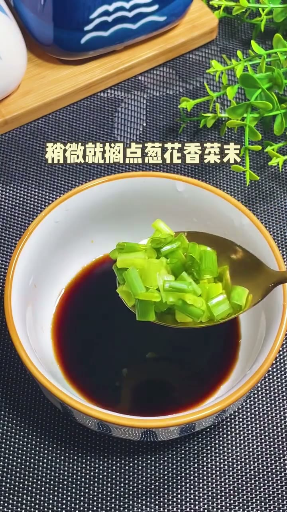
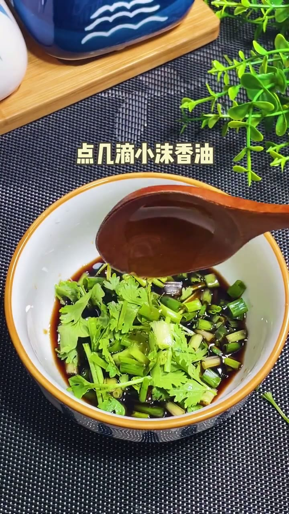

# 跟谦大爷学豆腐最简单朴素的吃法

> 豆腐切块焯水，趁热蘸酱油香油葱花汁，简单美味。

## 这条讲什么

视频解决如何用最简单朴素的方法吃豆腐。答案：新豆腐切成麻将块，用开水焯一下；小碗倒酱油，撒上葱花、香菜末，滴几滴香油调成蘸汁；豆腐趁热蘸酱油汤食用，被评价为天下美味之一。焯水可去除豆腥味并让豆腐更嫩；趁热食用能更好吸收酱油咸鲜和香油的香气。适合喜欢清淡口味、追求食材本味的人，尤其适合厨房新手。操作仅三步：切、焯、调汁，调料只有酱油、香油、葱、香菜，没有复杂步骤。该方法来自谦大爷，体现简单即美味的烹饪理念。

## 内容分节

### 00:00　豆腐切块焯水

- 新豆腐切成麻将块大小
- 用开水焯一下去除豆腥味

### 00:03　调制酱油蘸汁

- 倒一小碗酱油
- 撒上葱花和香菜末
- 滴几滴小碗香油

### 00:06　趁热蘸食

- 豆腐趁热吃
- 蘸着酱油汤食用
- 评价为天下美味之一

## 照着做

- 新豆腐切成麻将块
- 用开水焯一下
- 小碗倒酱油
- 加葱花、香菜末、几滴香油
- 豆腐趁热蘸酱油汤食用

## 原话

> 豆腐趁着热蘸着酱油汤

## 值得带走的

- 简单调味能突出食材本味
- 焯水可去豆腥味
- 趁热食用提升风味
- 香油几滴即可提香
- 酱油汤可做万能蘸料

## 总结

这个吃法成立在于豆腐本身清淡，焯水后口感更嫩，酱油与香油、葱花香菜提供咸鲜与香气，趁热食用能最大限度激发豆香。边界在于只适合嫩豆腐或北豆腐，老豆腐可能口感略柴；酱油用量可调整。最值得记住的是：最简单的做法往往最难超越，因为食材本味被充分尊重。

---
来源：[柒月优选 · 跟谦大爷学豆腐最简单朴素的吃法](https://www.xiaohongshu.com/explore/6108b73f0000000001000010?xsec_token=AB8hZAvB4bqCJT0A7JldK87gcE69RKEEJAR2ucsXmHOZM=&xsec_source=pc_collect)

## 相关笔记

- [[科普知识/广东人最爱吃的砂锅盐焗鸡]]
- [[技能教程/【100个摄影技巧】天空☁️如何𝐠𝐞𝐭日系风]]
- [[技能教程/教你把公交车拍出高级感📷赞爆朋友圈]]
